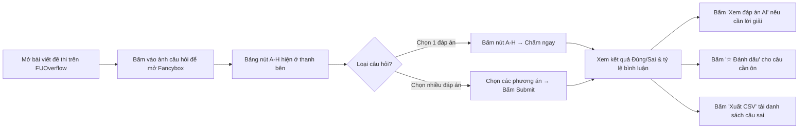

# FUO reUI — FUOverflow Practice Quiz Userscript

<p align="center">
  <a href="./docs/images/fuo-reui-demo.png">
    
  </a>
</p>

<p align="center">
  <strong>Luyện đề trắc nghiệm ngay trong trình xem ảnh của FUOverflow.</strong><br>
  <em>Dành cho sinh viên Đại học FPT ôn thi trên fuoverflow.com: ẩn bình luận để tự làm, bấm A–H chấm ngay theo phiếu cộng đồng hoặc AI, xuất câu sai ra CSV để ôn lại.</em>
</p>

<p align="center">
  <a href="https://raw.githubusercontent.com/bGiaHuy/fuo-reui/main/fuo-reui.user.js"></a>
  <a href="https://github.com/bGiaHuy/fuo-reui/actions"></a>
  <a href="#8-giới-hạn-và-tích-hợp"></a>
  <a href="./LICENSE"></a>
</p>

---

## Mục lục

1. [Tổng quan](#1-tổng-quan)
2. [Ảnh chụp thực tế](#2-ảnh-chụp-thực-tế)
3. [Cài đặt](#3-cài-đặt)
4. [Thông tin dự án](#4-thông-tin-dự-án)
5. [Vấn đề giải quyết](#5-vấn-đề-giải-quyết)
6. [Tính năng chính](#6-tính-năng-chính)
7. [Cách sử dụng](#7-cách-sử-dụng)
8. [Giới hạn và tích hợp](#8-giới-hạn-và-tích-hợp)
9. [Dữ liệu và quyền riêng tư](#9-dữ-liệu-và-quyền-riêng-tư)
10. [Thông tin cho người đóng góp](#10-thông-tin-cho-người-đóng-góp)
11. [Credits và License](#11-credits-và-license)

---

## 1. Tổng quan

- **Tên dự án:** **FUO reUI** (*FUOverflow Practice Quiz Userscript*)
- **Đối tượng sử dụng:** Sinh viên Đại học FPT và người dùng [FUOverflow](https://fuoverflow.com/) ôn thi trắc nghiệm (CEA201, PRF192, PRO192, CSI104, OSG202, NWC203, MAS291, ...).
- **Công dụng:** Gắn bảng chọn phương án `A–H` trực tiếp vào trình xem ảnh Fancybox của FUOverflow, mặc định ẩn bình luận để tự làm bài, chấm điểm theo số đông bình luận và hỗ trợ gọi AI giải thích từng phương án.

---

## 2. Ảnh chụp thực tế

Ảnh chụp khi luyện đề môn **CEA201 (Computer Organization and Architecture)** trên FUOverflow:

<p align="center">
  
</p>

> **Chú thích:**
> 1. **Bên trái (Ảnh đề thi):** Ảnh câu hỏi tiếng Anh hiển thị nguyên bản trong Fancybox.
> 2. **Góc trên bên phải (Bảng trả lời):** Hàng nút `A–H`. Trong ảnh, người dùng chọn `B` (đánh dấu đỏ `✗` vì sai) và bảng hiển thị đáp án đúng `D` (màu xanh `✓`).
> 3. **Trạng thái chấm điểm:** Ghi `Sai · Nguồn 1 bình luận`, tỷ lệ phiếu bình luận `D: 100%`.
> 4. **Khung lời giải AI (DeepSeek):** Giải thích lý do chọn `D` và chỉ ra chỗ sai ở các phương án `A`, `B`, `C`.

*(Script hỗ trợ cả chế độ **Chọn nhiều đáp án** kèm nút **Submit**. Từ bản `2.0.0`, bảng có thêm nút **Cài đặt AI** để đổi nhà cung cấp, model và mức suy nghĩ.)*

---

## 3. Cài đặt

Người dùng chỉ cần trình duyệt có Tampermonkey. Node.js và Python chỉ phục vụ phát triển hoặc chạy test.

### Bước 1: Cài Tampermonkey

**Khuyên dùng** *(Chrome, Edge, Brave, Cốc Cốc, Arc)*:

<p>
  <a href="https://chromewebstore.google.com/detail/tampermonkey/dhdgffkkebhmkfjojejmpbldmpobfkfo"></a>
</p>

> [!NOTE]
> Trên trình duyệt nhân Chromium bản mới, mở `chrome://extensions` (hoặc trang quản lý tiện ích của trình duyệt) và bật **Developer mode** / quyền chạy userscript nếu Tampermonkey yêu cầu.

**Lựa chọn thay thế** *(trình duyệt hoặc tiện ích khác)*:

<p>
  <a href="https://addons.mozilla.org/firefox/addon/tampermonkey/"></a>
  <a href="https://microsoftedge.microsoft.com/addons/detail/tampermonkey/iikmkjmpaadaobahmlepeloendndfphd"></a>
  <a href="https://apps.apple.com/app/tampermonkey/id1482490089"></a>
  <a href="https://addons.opera.com/extensions/details/tampermonkey-beta/"></a>
  <a href="https://violentmonkey.github.io/"></a>
</p>

### Bước 2: Cài Userscript

<p>
  <a href="https://raw.githubusercontent.com/bGiaHuy/fuo-reui/main/fuo-reui.user.js"></a>
</p>

1. Bấm nút **Cài đặt ngay** ở trên để mở file userscript trên nhánh `main`.
2. Khi Tampermonkey hiện trang cài đặt, bấm **Install** (hoặc **Update** nếu đã cài bản cũ).
3. Tải lại bài viết FUOverflow đang mở (`https://fuoverflow.com/threads/...`) và cho phép tiện ích chạy trên `fuoverflow.com` nếu trình duyệt hỏi quyền.

<details>
<summary>Trình duyệt chỉ mở trang mã nguồn thay vì trang cài đặt Tampermonkey?</summary>

Mở Dashboard Tampermonkey → **Create a new script**, thay nội dung mặc định bằng mã trong file [`fuo-reui.user.js`](./fuo-reui.user.js) rồi lưu (`Ctrl + S`). Tránh bật song song nhiều bản script cùng lúc.

</details>

<details>
<summary>Cài bằng bản Browser Extension (Manifest V3 — không cần Tampermonkey)</summary>

1. Tải gói `fuo-reui-extension-v3.0.0.zip` tại [GitHub Releases](https://github.com/bGiaHuy/fuo-reui/releases/latest) và giải nén (hoặc dùng trực tiếp thư mục `extension/` trong repo).
2. Mở `chrome://extensions` (Chrome/Edge/Brave), bật **Developer mode** → bấm **Load unpacked** → chọn thư mục vừa giải nén.
3. Mở bài viết đề thi trên `https://fuoverflow.com/threads/...` và bấm biểu tượng **FUO reUI** trên thanh công cụ khi cần mở menu thao tác nhanh.

</details>

---

## 4. Thông tin dự án

| Tiêu chí | Chi tiết |
| :--- | :--- |
| **Nền tảng hỗ trợ** | Chrome, Edge, Brave, Firefox, Safari, Opera qua **Tampermonkey** / **Violentmonkey**, hoặc cài trực tiếp bản **Extension (Manifest V3)**. |
| **Trạng thái** | **v3.0.1** — hỗ trợ tự kiểm tra cập nhật qua Tampermonkey, sẵn sàng metadata Greasy Fork, đã kiểm thử với **128 ca Playwright** cho cả desktop (`1280×800`) và mobile (`390×844`). |
| **License** | Mã nguồn mở theo **[MIT License](./LICENSE)**. |
| **Link bản mới nhất** | [`fuo-reui.user.js` trên nhánh `main`](https://raw.githubusercontent.com/bGiaHuy/fuo-reui/main/fuo-reui.user.js). |

---

## 5. Vấn đề giải quyết

Khi luyện đề trực tiếp từ các bài tổng hợp ảnh trên FUOverflow, người học thường gặp ba bất tiện:

1. **Dễ thấy trước đáp án:** Bình luận nằm ngay cạnh ảnh nên khó tự suy nghĩ trước khi nhìn thấy kết quả người khác đăng.
2. **Khó lọc bình luận:** Một câu có nhiều ý kiến khác nhau khiến bạn phải kéo đọc từng bình luận để tự ước lượng phương án đa số.
3. **Khó tổng hợp câu sai:** Làm xong một đề dài nhưng không có danh sách câu sai hoặc câu phân vân để ôn lại trước giờ thi.

FUO reUI chèn bảng trả lời vào thanh bên của Fancybox và mặc định ẩn bình luận. Khi bạn chọn phương án, script chấm theo tập bình luận có nhiều phiếu nhất; nếu chưa có phiếu hoặc hòa phiếu, script gọi AI (khi đã cấu hình) để lấy đáp án tham khảo và giải thích. Cuối buổi, bạn bấm **Xuất CSV** để lưu các câu sai và câu đánh dấu ra file dùng cho Excel, Google Sheets hoặc Anki.

---

## 6. Tính năng chính

- **Làm bài trực tiếp trên ảnh:** Bảng nút `A–H` nằm ở thanh bên Fancybox, không che đề. Tự phân biệt câu chọn một đáp án (chấm ngay khi bấm) và câu chọn nhiều đáp án (bấm **Submit** để chấm khớp cả tập).
- **Chấm theo đồng thuận cộng đồng:** Đọc bình luận của ảnh đang xem, bỏ phần trích dẫn, tính tối đa một phiếu hợp lệ cho mỗi tác giả và lấy tập đáp án nhiều phiếu nhất.
- **Nhận diện loại câu hỏi qua OCR & lưu cache:** Khi chưa có bình luận hợp lệ, Tesseract.js (`eng+vie`) đọc ảnh để phân biệt câu chọn một hay chọn nhiều; kết quả được lưu vào `GM_setValue` (`fuoOcrTypeCache`) theo URL ổn định để tránh chạy lại OCR khi tải lại trang.
- **Lời giải AI (BYOK đa nhà cung cấp):** Hỗ trợ sẵn 5 preset (`DeepSeek`, `OpenAI`, `Anthropic Claude`, `Google Gemini`, `OpenRouter`) và tối đa `20` hồ sơ tùy chỉnh; cho tải `/models`, chỉnh mức `Thinking` và hiển thị công thức toán bằng KaTeX.
- **Hỗ trợ Local LLM:** Kết nối trực tiếp Ollama (`http://localhost:11434/v1`) hoặc LM Studio (`http://localhost:1234/v1`) mà không cần API key.
- **Chế độ thi thử bấm giờ & vòng ôn tập:** Bật **Thi thử** để làm liền mạch cả đề có đồng hồ đếm ngược, ẩn đúng/sai từng câu và chấm tổng điểm khi bấm **Nộp bài**; bật **Ôn tập** để lặp riêng các câu đã sai hoặc gắn sao đến khi làm đúng hết.
- **Sao lưu JSON, xuất CSV & thẻ Anki:** Lưu lịch sử theo từng bài viết; hỗ trợ xuất CSV, xuất thẻ **Anki (`.tsv`)** và sao lưu/khôi phục tiến độ qua file **JSON** (không gồm API key).
- **Thanh tiến độ, nhảy nhanh & phím tắt:** Hiển thị số câu đã làm, tỷ lệ đúng và nút nhảy trực tiếp tới **Câu sai** / **Câu gắn sao** ngay trên bảng, kèm phím tắt bàn phím cho toàn bộ thao tác chính.

---

## 7. Cách sử dụng



### Các nút thao tác cơ bản

- **`Làm lại`**: Xóa lựa chọn và kết quả đang hiện của câu hiện tại để làm lại; vẫn giữ phân loại, dấu sao và lịch sử câu đã từng sai.
- **`Hiện bình luận` / `Ẩn bình luận`**: Mặc định ẩn bình luận để tự làm; bấm khi muốn đọc thảo luận của ảnh đang xem.
- **`Xem đáp án AI`**: Gọi nhà cung cấp AI đang chọn để lấy đáp án tham khảo và lời giải tiếng Việt; thao tác này không chấm câu hỏi.
- **`Cài đặt AI`**: Mở hộp thoại chọn nhà cung cấp, chỉnh Base URL, loại tương thích, đặt API key, tải danh sách `/models` và chọn mức `Thinking`.
- **`☆ Đánh dấu` / `★ Đã đánh dấu`**: Gắn hoặc bỏ dấu sao cho câu muốn ôn lại.
- **`Xuất CSV`**: Tải file `<tên đề>_cau-can-on.csv` chứa các câu đã sai hoặc được đánh dấu của đề hiện tại.
- **`Sao lưu`**: Mở hộp thoại xuất thẻ **Anki (`.tsv`)**, **Sao lưu JSON** và **Khôi phục JSON** (tiến độ, cache OCR và cấu hình AI, không gồm API key).
- **`Thi thử`**: Bắt đầu chế độ thi thử bấm giờ (1–300 phút), ẩn đúng/sai từng câu và khóa bình luận/AI cho đến khi bấm **Nộp bài**.
- **`Câu sai (N)` / `Câu gắn sao (N)` / `Ôn tập (N)`**: Hiện ngay dưới thanh tiến độ khi đã có dữ liệu; dùng để nhảy nhanh qua từng câu cần xem lại hoặc mở vòng ôn tập làm lại đến khi đúng hết.

### Phím tắt bàn phím

| Phím | Thao tác |
| :--- | :--- |
| `A`–`H` hoặc `1`–`8` | Chọn phương án `A`–`H` (khi câu hỏi chưa chấm) |
| `Enter` | Nộp đáp án (**Submit**) với câu chọn nhiều |
| `R` | **Làm lại** câu hiện tại |
| `S` | Gắn hoặc bỏ **Đánh dấu sao** |
| `M` (hoặc `C` sau khi chấm) | **Hiện / Ẩn bình luận** |
| `I` (hoặc `E` sau khi chấm) | **Xem đáp án AI** |

*(Phím tắt tự tắt khi đang mở hộp thoại **Cài đặt AI** hoặc khi con trỏ nằm trong ô nhập chữ.)*

*(Để xóa lịch sử làm bài và dấu sao của đề đang mở, vào menu Tampermonkey → **Bắt đầu lượt luyện đề mới**.)*

---

## 8. Giới hạn và tích hợp

- **Phạm vi hoạt động:** Chỉ chạy trên `https://fuoverflow.com/threads/*` theo cấu trúc Fancybox hiện tại của FUOverflow; không hỗ trợ các trang luyện thi khác.
- **Tài khoản & Quota AI:**
  - Chấm theo bình luận và OCR không cần tài khoản hay API key.
  - Tính năng AI chạy theo mô hình **BYOK (Bring Your Own Key)**: chi phí và hạn mức tính theo tài khoản API cá nhân của bạn (DeepSeek, OpenAI, Claude, Gemini, OpenRouter), trừ khi dùng endpoint HTTP cục bộ (`localhost`, `127.0.0.1`, `[::1]`).
- **Độ tin cậy & giới hạn kỹ thuật:** Cả bình luận cộng đồng và AI đều là nguồn tham khảo; phần trăm hiển thị là tỷ lệ phiếu bình luận, không phải xác suất đúng. Luồng AI chỉ đọc ảnh cùng origin với trang (`PNG/JPEG/WebP/GIF`, tối đa `15 MB`). Timeout: `15s` cho `/models`; `60s` (`default`/`off`), `90s` (`low`/`medium`) hoặc `120s` (`high`) cho AI; `60s` mỗi bước cho OCR.
- **Chưa hỗ trợ:** Chưa đồng bộ tự động qua đám mây giữa nhiều thiết bị — dùng **Sao lưu JSON** / **Khôi phục JSON** (hoặc xuất CSV / Anki `.tsv`) khi chuyển máy.

---

## 9. Dữ liệu và quyền riêng tư

- **Lưu trữ cục bộ:** Lịch sử câu sai, dấu sao (`fuoReview:*`), cấu hình AI (`fuoAIConfig`) và API key (`fuoAIKeys`) lưu trong bộ nhớ userscript của Tampermonkey trên máy bạn. Không có máy chủ trung gian hay đồng bộ đám mây.
- **Bảo vệ API Key:**
  - Key chỉ nhập qua hộp thoại `prompt()` của trình duyệt và không ghi vào DOM, `<input>`, `localStorage`, `sessionStorage`, `console.*` hay file CSV.
  - Mỗi key gắn với một origin (`scheme + host + port`): khi đổi Base URL sang domain khác và lưu, script tự xóa key cũ để tránh gửi nhầm sang máy chủ khác.
  - Thông báo lỗi HTTP từ nhà cung cấp đi qua bộ lọc ẩn bí mật (`[REDACTED]`) trước khi hiển thị.
- **Dữ liệu gửi ra ngoài:** Không gắn telemetry hay theo dõi hành vi. Chỉ khi bạn bấm **Xem đáp án AI** hoặc khi cần AI chấm (không có phiếu / hòa phiếu), trình duyệt mới gửi ảnh câu hỏi và lựa chọn hiện tại trực tiếp tới endpoint bạn đã cấu hình qua `GM_xmlhttpRequest` (`anonymous: true`, không kèm cookie). Khi dùng domain tùy chỉnh mới, Tampermonkey sẽ hỏi xác nhận quyền `@connect`.

---

## 10. Thông tin cho người đóng góp

- **Công nghệ & cấu trúc mã nguồn:** Mã nguồn tách theo module trong `src/` (`meta.js`, `state.js`, `styles.js`, `ai-config.js`, `ai-client.js`, `ui.js`), build bằng `scripts/build.js` (không phụ thuộc bundler ngoài) ra đồng thời [`fuo-reui.user.js`](./fuo-reui.user.js) và [`extension/core.js`](./extension/core.js) dùng chung cho bản Extension MV3 (`extension/`). Phụ thuộc runtime: Tesseract.js `5.1.1`, KaTeX `0.19.1`; kiểm thử: Playwright `1.56.1`.
- **Build & chạy kiểm thử tự động (128 ca trên Desktop và Mobile):**
  ```sh
  git clone https://github.com/bGiaHuy/fuo-reui.git
  cd fuo-reui
  npm ci
  npm run build:check
  npx playwright install chromium
  npm test
  ```
  Sau khi sửa file trong `src/`, chạy `npm run build` để cập nhật lại `fuo-reui.user.js` và `extension/core.js`.
  Chạy riêng một viewport:
  ```sh
  npm test -- --project=desktop
  npm test -- --project=mobile
  ```
- **Chạy trang mẫu thủ công (cần Python 3):**
  ```sh
  python3 -m http.server 8765
  ```
  Mở `http://localhost:8765/tests/fixture.html` (mô phỏng đầy đủ bình luận, BYOK, CSV không cần Tampermonkey) hoặc `http://localhost:8765/tests/ocr.html` (thử Tesseract OCR qua CDN).
- **Báo lỗi & gửi thay đổi:** Mở Issue hoặc gửi Pull Request tại [bGiaHuy/fuo-reui](https://github.com/bGiaHuy/fuo-reui).

---

## 11. Credits và License

### Nhóm phát triển & đóng góp

- **Gia Huy Bùi** ([@bGiaHuy](https://github.com/bGiaHuy)) — tác giả gốc của repo và userscript ban đầu, cải thiện giao diện đọc lời giải AI trên sidebar và kiểm duyệt cấu hình BYOK.
- **Phùng Xuân Bách** ([@Gokigenzo](https://github.com/Gokigenzo)) — đồng phát triển: phân loại câu hỏi theo phiếu bình luận và OCR, lời giải AI kèm KaTeX, đánh dấu sao, xuất CSV, nhận diện tên ảnh linh hoạt (`v1.5.3`) và tách ảnh trùng tên (`v1.5.4`).
- **thanh huy** ([@premierere](https://github.com/premierere)) — đóng góp AI BYOK đa nhà cung cấp, tải danh sách `/models` và điều chỉnh mức suy nghĩ (`Thinking`).

### Thư viện và nền tảng

- [KaTeX](https://katex.org/) — hiển thị công thức toán.
- [Tesseract.js](https://tesseract.projectnaptha.com/) — OCR phân loại câu hỏi trên trình duyệt.
- [Playwright](https://playwright.dev/) — kiểm thử tự động desktop và mobile.
- [Tampermonkey](https://www.tampermonkey.net/) — trình chạy userscript.
- [FUOverflow](https://fuoverflow.com/) — diễn đàn nguồn đề thi; dự án phát triển độc lập, không trực thuộc FUOverflow.

### License

Phát hành theo **[MIT License](./LICENSE)**.
