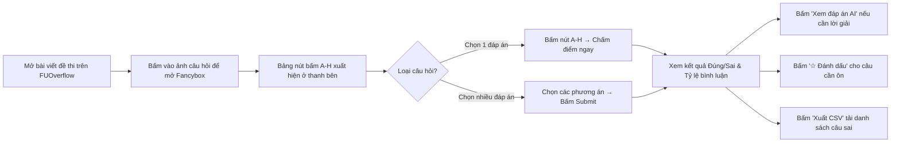

# FUO reUI — FUOverflow Practice Quiz Userscript

<p align="center">
  <a href="./docs/images/fuo-reui-demo.png">
    
  </a>
</p>

<p align="center">
  <strong>Biến diễn đàn FUOverflow thành phòng luyện đề trắc nghiệm chuẩn thi thực chiến.</strong><br>
  <em>Dành riêng cho sinh viên Đại học FPT: Tạm biệt việc vừa soi ảnh vừa kéo comment dò đáp án. Trả lời ngay trên thanh bên, tự động chấm theo bình luận cộng đồng và giải thích chi tiết cùng AI.</em>
</p>

<p align="center">
  <a href="https://raw.githubusercontent.com/bGiaHuy/fuo-reui/main/fuo-reui.user.js"></a>
  <a href="https://github.com/bGiaHuy/fuo-reui/actions"></a>
  <a href="#8-giới-hạn-và-tích-hợp"></a>
  <a href="#11-credits-và-licence"></a>
</p>

---

## 📑 Mục lục

1. [Mở đầu bắt mắt](#1-mở-đầu-bắt-mắt)
2. [Bằng chứng trực quan](#2-bằng-chứng-trực-quan)
3. [Dấu hiệu tin cậy](#3-dấu-hiệu-tin-cậy)
4. [Giới thiệu ngắn](#4-giới-thiệu-ngắn)
5. [Tính năng chính](#5-tính-năng-chính)
6. [Cách bắt đầu (Cài đặt trong 1 phút)](#6-cách-bắt-đầu-cài-đặt-trong-1-phút)
7. [Cách sử dụng](#7-cách-sử-dụng)
8. [Giới hạn và tích hợp](#8-giới-hạn-và-tích-hợp)
9. [Dữ liệu và quyền riêng tư](#9-dữ-liệu-và-quyền-riêng-tư)
10. [Thông tin cho người đóng góp](#10-thông-tin-cho-người-đóng-góp)
11. [Credits và licence](#11-credits-và-licence)

---

## 1. Mở đầu bắt mắt

- **Tên dự án:** **FUO reUI** (*FUOverflow Practice Quiz Userscript*)
- **Dành cho ai:** Sinh viên Đại học FPT (và người dùng diễn đàn FUOverflow) đang ôn luyện các môn thi trắc nghiệm FE/PE (CEA201, PRF192, PRO192, CSI104, OSG202, NWC203, MAS291,...).
- **Giải quyết việc gì:** Loại bỏ hoàn toàn sự ức chế khi phải lướt qua lại giữa album ảnh đề thi và khu vực bình luận để tự mò đáp án. Script tích hợp bảng chọn phương án trực tiếp vào giao diện trình xem ảnh, tự động chấm điểm theo số đông bình luận và gọi AI phân tích sâu từng câu hỏi.

---

## 2. Bằng chứng trực quan

Ảnh chụp màn hình thực tế khi đang luyện đề môn **CEA201 (Computer Organization and Architecture)** trên diễn đàn FUOverflow:

<p align="center">
  
</p>

> **Chú thích hình ảnh thực tế:**
> 1. **Bên trái (Ảnh đề thi):** Câu hỏi trắc nghiệm tiếng Anh hiển thị nguyên bản trong popup Fancybox.
> 2. **Góc trên bên phải (Bảng trả lời):** Hàng nút bấm chọn đáp án từ `A` đến `H`. Trong ảnh: Người dùng chọn `B` (báo đỏ $\times$ vì sai), hệ thống tự động nhận diện và làm nổi bật đáp án đúng `D` (báo xanh $\checkmark$).
> 3. **Dòng trạng thái đồng thuận:** Báo `Sai - Nguồn 1 bình luận`, tỷ lệ đồng thuận bình luận `D: 100%`.
> 4. **Khung giải thích AI (DeepSeek):** Phân tích rõ ràng tại sao phương án `D` là đặc tính cốt lõi của hệ thống phân cấp (*hierarchical system*), đồng thời chỉ rõ lỗi sai của từng phương án `A`, `B` và `C`.

*(Hỗ trợ cả chế độ **Chọn nhiều đáp án** với nút `Submit` riêng biệt khi gặp câu hỏi dạng multi-choice).*

---

## 3. Dấu hiệu tin cậy

| Tiêu chí | Thông tin kiểm chứng |
| :--- | :--- |
| **Nền tảng hỗ trợ** | Hoạt động trên mọi trình duyệt hiện đại (Chrome, Edge, Firefox, Brave, Safari, Opera) thông qua **Tampermonkey** hoặc **Violentmonkey**. |
| **Trạng thái dự án** | **v2.0.0** — Hoạt động ổn định, bộ kiểm thử tự động gồm **108 bài test Playwright** chạy thông suốt trên cả Desktop và Mobile. |
| **licence** | Mã nguồn mở hoàn toàn theo chuẩn **MIT License**. |
| **Link cài đặt bản mới nhất** | [`fuo-reui.user.js` trên nhánh `main`](https://raw.githubusercontent.com/bGiaHuy/fuo-reui/main/fuo-reui.user.js). |

---

## 4. Giới thiệu ngắn

Khi ôn thi trắc nghiệm trên FUOverflow, sinh viên thường vấp phải 3 rào cản lớn:
1. **Dễ lộ đáp án:** Vừa mở ảnh lên là bình luận bên dưới đập ngay vào mắt, làm mất khả năng tự tư duy và phản xạ phòng thi.
2. **Bình luận gây nhiễu:** Người bảo A, người bảo B, tranh cãi kéo dài mà không có người chốt đáp án chuẩn xác.
3. **Không lưu được lỗi sai:** Làm xong một đề 50 câu, không nhớ mình đã sai những câu nào để ôn lại trước ngày thi.

**FUO reUI là lời giải trọn vẹn:** Tiện ích ẩn bình luận đi để bạn tự chọn đáp án; ngay khi chọn xong, thuật toán sẽ tự kiểm tra xem số đông bình luận chọn gì để chấm cho bạn. Nếu bình luận thiếu hoặc tranh cãi, trợ lý AI sẽ lập tức nhảy vào giải thích chi tiết từng ngóc ngách. Cuối buổi, bạn chỉ cần bấm **Xuất CSV** là có ngay danh sách câu sai để nhét vào Anki hoặc Excel.

---

## 5. Tính năng chính

- 🎯 **Luyện đề trực tiếp trên ảnh:** Giao diện nút bấm A–H tối giản, bám sát thanh bên Fancybox, không che khuất nội dung đề thi. Tự động hỗ trợ cả câu chọn 1 đáp án và câu chọn nhiều đáp án (*Multi-choice Submit*).
- ⚡ **Chấm điểm theo đồng thuận cộng đồng (Plurality Voting):** Đọc bình luận thực tế, lọc bỏ quote/trích dẫn, tính mỗi tác giả 1 phiếu và lấy tập đáp án chiếm đa số làm căn cứ chấm điểm.
- 🔍 **Nhận diện loại câu hỏi qua OCR:** Nếu bình luận chưa ai làm, thư viện Tesseract.js tích hợp sẵn sẽ tự đọc ảnh để phân loại câu hỏi (chọn 1 hay chọn tất cả).
- 🤖 **Trợ lý giải đề AI (BYOK đa nhà cung cấp):** Kết nối trực tiếp tới DeepSeek, OpenAI (GPT-4o/mini), Anthropic Claude, Google Gemini hoặc OpenRouter để giải thích chi tiết bằng tiếng Việt kèm công thức Toán/Lý KaTeX sắc nét.
- 💻 **Hỗ trợ Local LLM (Chạy AI không tốn tiền):** Kết nối mượt mà tới Ollama hoặc LM Studio qua `localhost` mà không cần API key.
- 📁 **Quản lý câu hỏi & Xuất CSV ôn tập:** Đánh dấu câu khó (☆/★), tự động lưu lịch sử các câu làm sai và xuất file CSV chuẩn cấu trúc chỉ với 1 cú click.

---

## 6. Cách bắt đầu (Cài đặt trong 1 phút)

### Yêu cầu tiên quyết
Bạn chỉ cần cài tiện ích **Tampermonkey** trên trình duyệt của mình:

| Trình duyệt | Link cài đặt Tampermonkey |
| :--- | :--- |
| **Chrome / Brave** | [Chrome Web Store](https://chromewebstore.google.com/detail/tampermonkey/dhdgffkkebhmkfjojejmpbldmpobfkfo) *(Lưu ý: Bật "Developer mode" tại `chrome://extensions` nếu Chrome yêu cầu)* |
| **Mozilla Firefox** | [Firefox Add-ons (AMO)](https://addons.mozilla.org/firefox/addon/tampermonkey/) |
| **Microsoft Edge** | [Edge Add-ons](https://microsoftedge.microsoft.com/addons/detail/tampermonkey/iikmkjmpaadaobahmlepeloendndfphd) |
| **Mọi trình duyệt khác** | [Tampermonkey Homepage](https://www.tampermonkey.net/) hoặc [Violentmonkey](https://violentmonkey.github.io/) |

### Cài đặt Userscript
1. Bấm vào liên kết cài đặt: 👉 **[Cài đặt fuo-reui.user.js](https://raw.githubusercontent.com/bGiaHuy/fuo-reui/main/fuo-reui.user.js)**.
2. Trình duyệt sẽ mở ra trang cài đặt của Tampermonkey → Nhấn **Install** (hoặc **Cài đặt**).
3. Mở bài viết đề thi bất kỳ trên FUOverflow (ví dụ: `https://fuoverflow.com/threads/...`) và bắt đầu luyện!

---

## 7. Cách sử dụng



### Các nút thao tác cơ bản:
- **`Làm lại`**: Xóa kết quả vừa bấm để tự làm lại câu hiện tại mà không làm mất lịch sử câu đã từng sai.
- **`Hiện bình luận` / `Ẩn bình luận`**: Mặc định bình luận bị ẩn để tránh spoil; bấm nút này nếu muốn xem mọi người thảo luận gì.
- **`Xem đáp án AI`**: Gọi AI phân tích câu hỏi và giải thích từng phương án đúng/sai.
- **`Cài đặt AI`**: Mở bảng chọn nhà cung cấp AI, nhập key, test model `/models` và điều chỉnh mức suy nghĩ (*Thinking*).
- **`☆ Đánh dấu`**: Đánh dấu câu hỏi cần xem lại đặc biệt.
- **`Xuất CSV`**: Tải về file `<Tên_đề>_cau-can-on.csv` để nhập vào Excel hoặc Anki.

---

## 8. Giới hạn và tích hợp

- **Yêu cầu môi trường:** Tiện ích hoạt động dựa trên cấu trúc trình xem ảnh Fancybox của diễn đàn `fuoverflow.com/threads/*`. Không áp dụng cho các trang web thi thử khác ngoài FUOverflow.
- **Tài khoản & Quota AI:**
  - Chức năng chấm theo bình luận và OCR nhận diện: **Hoàn toàn miễn phí 100%**, không cần tài khoản hay API key.
  - Chức năng AI hoạt động theo mô hình **BYOK (Bring Your Own Key)**: Bạn tự dùng API key cá nhân của DeepSeek, OpenAI, Claude, Gemini hoặc kết nối Localhost Ollama miễn phí. Chi phí API (nếu có) do bạn tự quản lý theo quota tài khoản của mình.
- **Xử lý dữ liệu AI:** Script chỉ gửi ảnh câu hỏi và phương án bạn chọn đến endpoint AI khi bạn chủ động bấm nút *Xem đáp án AI* hoặc khi đề thi hòa phiếu/không có bình luận.
- **Tính năng chưa hỗ trợ:** Chưa hỗ trợ đồng bộ dữ liệu qua tài khoản đám mây giữa nhiều máy tính khác nhau (hãy dùng tính năng Xuất CSV để lưu giữ kết quả học tập).

---

## 9. Dữ liệu và quyền riêng tư

- **Lưu trữ 100% cục bộ (Zero Cloud Storage):** Mọi lịch sử làm bài, danh sách câu sai, câu đánh dấu và cấu hình cá nhân được lưu hoàn toàn trong bộ nhớ an toàn của Tampermonkey (`GM_getValue`/`GM_setValue`) trên máy tính của bạn.
- **Bảo mật API Key tuyệt đối:**
  - API Key chỉ được nhập qua hộp thoại `prompt()` nguyên bản của trình duyệt và lưu vào kho riêng `fuoAIKeys`.
  - **Không bao giờ** ghi key vào mã HTML DOM, không lưu trong `localStorage`/`sessionStorage`, không in ra `console.log` và không đưa vào file CSV.
  - Tự động xóa key khi bạn đổi sang tên miền khác (Origin-bound protection) để ngăn ngừa rủi ro gửi nhầm key sang server lạ.
- **Không thu thập dữ liệu (No Telemetry):** Không cài mã theo dõi, không gửi dữ liệu hành vi người dùng về bất kỳ máy chủ nào.

---

## 10. Thông tin cho người đóng góp

Chúng tôi luôn hoan nghênh các đóng góp (Pull Request), báo lỗi (Issue) hoặc ý tưởng nâng cấp giao diện từ cộng đồng sinh viên!

- **Công nghệ sử dụng:** Vanilla JavaScript (ES6+), Tampermonkey API (`GM_*`), Tesseract.js (OCR), KaTeX (Math rendering), Playwright (E2E Testing).
- **Cấu trúc mã nguồn:** Toàn bộ userscript gói gọn trong file duy nhất `fuo-reui.user.js` (không cần bước build/bundle phức tạp).
- **Quy trình chạy kiểm thử tự động:**
  ```bash
  # 1. Clone repo
  git clone https://github.com/bGiaHuy/fuo-reui.git
  cd fuo-reui

  # 2. Cài đặt môi trường test
  npm ci
  npx playwright install chromium

  # 3. Chạy 108 test cases tự động
  npm test

  # 4. Chạy riêng desktop hoặc mobile
  npm test -- --project=desktop
  npm test -- --project=mobile
  ```
- **Báo lỗi & Đóng góp:** Tạo Issue hoặc gửi Pull Request tại [GitHub Repository](https://github.com/bGiaHuy/fuo-reui).

---

## 11. Credits và licence

### Nhóm phát triển & Đóng góp
- **Gia Huy Bùi ([@bGiaHuy](https://github.com/bGiaHuy))** — *Maintainer & Tác giả chính*: Thiết kế kiến trúc BYOK AI đa nhà cung cấp, hệ thống cấu hình model/thinking, nâng cấp giao diện dark mode hiện đại, tích hợp công thức KaTeX và toàn bộ test suite Playwright.
- **Phùng Xuân Bách ([@lthpxb2007](https://github.com/lthpxb2007))** — *Tác giả khởi xướng (Original Creator)*: Khởi tạo phiên bản userscript đầu tiên, xây dựng thuật toán chấm điểm theo đồng thuận bình luận và tích hợp OCR nhận diện loại câu hỏi.
- **premierere ([@huy076b2](https://github.com/premierere))** — *Contributor*: Đóng góp hoàn thiện tính năng BYOK, tự động khám phá model `/models` và điều khiển mức suy nghĩ.

### Thư viện bên thứ ba
- [KaTeX](https://katex.org/) (Khan Academy) — Hiển thị công thức Toán học.
- [Tesseract.js](https://tesseract.projectnaptha.com/) — Nhận diện ký tự quang học OCR.
- [Playwright](https://playwright.dev/) (Microsoft) — Bộ kiểm thử tự động End-to-End.
- [Diễn đàn FUOverflow](https://fuoverflow.com/) — Nền tảng chia sẻ tài liệu của sinh viên FPT.

### licence (License)
Phát hành theo licence mã nguồn mở **MIT License**. Bạn được tự do sử dụng, chỉnh sửa và phân phối lại vì mục đích phi thương mại và học tập.
