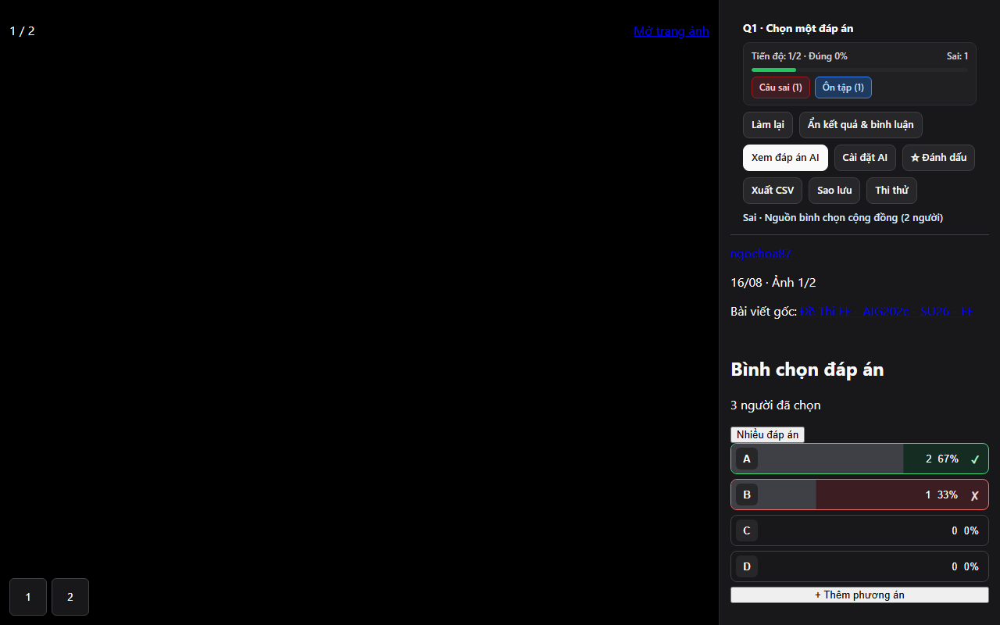
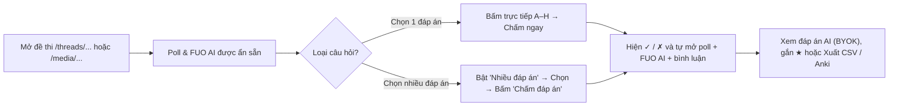

# FUO reUI — FUOverflow Practice Quiz Userscript & Extension

<p align="center">
  <a href="./docs/images/fuo-reui-demo.png">
    
  </a>
</p>

<p align="center">
  <strong>Luyện đề trắc nghiệm trên giao diện mới của FUOverflow mà không bị lộ đáp án từ tỷ lệ bình chọn hay bình luận AI ghim.</strong><br>
  <em>Dành cho sinh viên Đại học FPT ôn thi trên fuoverflow.com: che tỷ lệ poll, FUO AI và bình luận trước khi làm; bấm trực tiếp phương án A–H để chấm 3 tầng; hỗ trợ thi thử bấm giờ, vòng ôn tập và xuất CSV / Anki / JSON.</em>
</p>

<p align="center">
  <a href="https://raw.githubusercontent.com/bGiaHuy/fuo-reui/main/fuo-reui.user.js"></a>
  <a href="https://github.com/bGiaHuy/fuo-reui/actions"></a>
  <a href="#8-giới-hạn-và-tích-hợp"></a>
  <a href="./LICENSE"></a>
</p>

---

## Mục lục

1. [Tổng quan](#1-tổng-quan)
2. [Ảnh chụp thực tế](#2-ảnh-chụp-thực-tế)
3. [Cài đặt](#3-cài-đặt)
4. [Thông tin dự án](#4-thông-tin-dự-án)
5. [Vấn đề giải quyết](#5-vấn-đề-giải-quyết)
6. [Tính năng chính](#6-tính-năng-chính)
7. [Cách sử dụng](#7-cách-sử-dụng)
8. [Giới hạn và tích hợp](#8-giới-hạn-và-tích-hợp)
9. [Dữ liệu và quyền riêng tư](#9-dữ-liệu-và-quyền-riêng-tư)
10. [Thông tin cho người đóng góp](#10-thông-tin-cho-người-đóng-góp)
11. [Credits và License](#11-credits-và-license)

---

## 1. Tổng quan

- **Tên dự án:** **FUO reUI** (*FUOverflow Practice Quiz Userscript & Browser Extension*)
- **Đối tượng sử dụng:** Sinh viên Đại học FPT và người dùng [FUOverflow](https://fuoverflow.com/) ôn thi trắc nghiệm.
- **Công dụng:** Che tỷ lệ phần trăm trên bảng **Bình chọn đáp án**, card **FUO AI** ghim và danh sách bình luận cho tới khi bạn chọn đáp án; tích hợp bảng điều khiển luyện đề ngay trong trình xem ảnh lightbox và trang `/media/*` (desktop lẫn mobile).

---

## 2. Ảnh chụp thực tế

Ảnh chụp thực tế từ trang kiểm thử mô phỏng [tests/fixture.html](./tests/fixture.html) chạy `fuo-reui.user.js` v4.0.0:

<p align="center">
  
</p>

> **Chú thích:**
> 1. **Thanh điều khiển FUO reUI (góc trên bên phải):** Hiển thị câu hiện tại (`Q1 · Chọn một đáp án`), thanh tiến độ (`Tiến độ: 1/2 · Đúng 0%`), nút nhảy nhanh `Câu sai (1)` / `Ôn tập (1)`, các nút thao tác và kết quả chấm `Sai · Nguồn bình chọn cộng đồng (2 người)`.
> 2. **Bảng Bình chọn đáp án gốc:** Trước khi bấm chọn, số người chọn, thanh phần trăm và bình luận được ẩn hoàn toàn. Sau khi bấm `B`, nút `A` hiện viền xanh (`✓`), nút `B` hiện viền đỏ (`✗`), đồng thời tỷ lệ poll và bình luận `FUO AI` tự động mở lại để đối chiếu.

---

## 3. Cài đặt

Người dùng cuối chỉ cần trình duyệt có Tampermonkey (hoặc cài trực tiếp gói Browser Extension). Node.js và Python chỉ phục vụ phát triển, build hoặc chạy kiểm thử.

### Bước 1: Cài Tampermonkey

**Khuyên dùng** *(Chrome, Edge, Brave, Cốc Cốc, Arc)*:

<p>
  <a href="https://chromewebstore.google.com/detail/tampermonkey/dhdgffkkebhmkfjojejmpbldmpobfkfo"></a>
</p>

> [!NOTE]
> Trên trình duyệt nhân Chromium bản mới, mở `chrome://extensions` và bật **Developer mode** / quyền chạy userscript nếu Tampermonkey yêu cầu.

**Lựa chọn thay thế:**

<p>
  <a href="https://addons.mozilla.org/firefox/addon/tampermonkey/"></a>
  <a href="https://microsoftedge.microsoft.com/addons/detail/tampermonkey/iikmkjmpaadaobahmlepeloendndfphd"></a>
  <a href="https://apps.apple.com/app/tampermonkey/id1482490089"></a>
  <a href="https://addons.opera.com/extensions/details/tampermonkey-beta/"></a>
  <a href="https://violentmonkey.github.io/"></a>
</p>

### Bước 2: Cài Userscript

<p>
  <a href="https://raw.githubusercontent.com/bGiaHuy/fuo-reui/main/fuo-reui.user.js"></a>
</p>

1. Bấm nút **Cài đặt ngay** ở trên để mở file userscript trên nhánh `main`.
2. Khi Tampermonkey hiện trang cài đặt, bấm **Install** (hoặc **Update** nếu đã cài bản cũ).
3. Tải lại bài viết FUOverflow (`https://fuoverflow.com/threads/...` hoặc `https://fuoverflow.com/media/...`) và cho phép chạy trên `fuoverflow.com` nếu trình duyệt hỏi quyền.

<details>
<summary>Trình duyệt chỉ mở trang mã nguồn thay vì trang cài đặt Tampermonkey?</summary>

Mở Dashboard Tampermonkey → **Create a new script**, thay nội dung mặc định bằng mã trong file [`fuo-reui.user.js`](./fuo-reui.user.js) rồi lưu (`Ctrl + S`). Tránh bật song song nhiều bản script cùng lúc.

</details>

<details>
<summary>Cài bằng bản Browser Extension (Manifest V3 — không cần Tampermonkey)</summary>

1. Tải mã nguồn hoặc thư mục [`extension/`](./extension) trong repo (chạy `npm run build` nếu vừa sửa `src/`).
2. Mở `chrome://extensions` (Chrome/Edge/Brave), bật **Developer mode** → bấm **Load unpacked** → chọn thư mục `extension/`.
3. Mở đề thi trên `https://fuoverflow.com/` và bấm biểu tượng **FUO reUI** trên thanh công cụ khi cần mở menu thao tác nhanh.

</details>

---

## 4. Thông tin dự án

| Tiêu chí | Chi tiết |
| :--- | :--- |
| **Nền tảng hỗ trợ** | Chrome, Edge, Brave, Firefox, Safari, Opera qua **Tampermonkey** / **Violentmonkey**, hoặc cài trực tiếp bản **Extension (Manifest V3)**. |
| **Trạng thái** | **v4.0.0** — hỗ trợ giao diện Next.js mới của FUOverflow (cả lightbox `/threads/*` và trang `/media/*`), tự kiểm tra cập nhật qua Tampermonkey, đã kiểm thử **60 ca Playwright** trên desktop (`1280×800`) và mobile (`390×844`). |
| **License** | Mã nguồn mở theo **[MIT License](./LICENSE)**. |
| **Link bản mới nhất** | [`fuo-reui.user.js` trên nhánh `main`](https://raw.githubusercontent.com/bGiaHuy/fuo-reui/main/fuo-reui.user.js). |

---

## 5. Vấn đề giải quyết

Sau khi FUOverflow chuyển sang nền tảng mới, mỗi ảnh câu hỏi có sẵn bảng **Bình chọn đáp án** hiển thị ngay số phiếu, thanh phần trăm và bình luận ghim từ **FUO AI**. Điều này làm lộ đáp án ngay từ cái nhìn đầu tiên và phá vỡ trải nghiệm tự ôn luyện.

**FUO reUI v4.0.0** giữ nguyên các nút chọn phương án gốc của FUOverflow nhưng dùng CSS tiêm từ `@run-at document-start` để ẩn sạch số liệu thống kê, thanh phần trăm, card **FUO AI** và bình luận trước khi bạn trả lời. Khi bạn chọn phương án, script chấm theo 3 tầng ưu tiên rõ ràng rồi tự động mở lại kết quả để bạn đối chiếu, đồng thời lưu tiến độ theo đúng bài viết gốc (`/threads/...`).

---

## 6. Tính năng chính

- **Che spoiler không nháy hình (Zero-flash shield):** Ẩn tổng số người chọn, thanh phần trăm `scaleX`, số phiếu từng phương án, card ghim `FUO AI` và bình luận khi chưa trả lời; vẫn giữ nguyên khung nhập bình luận và widget Cloudflare Turnstile.
- **Chấm trực tiếp trên bảng bình chọn gốc:** Bấm nút `A–H` của FUOverflow để chấm ngay (câu chọn một) hoặc chọn nhiều rồi bấm **Chấm đáp án** (câu chọn nhiều). Phiếu tự chọn trước đó của chính bạn được loại khỏi mẫu số cộng đồng.
- **Ưu tiên nguồn đáp án 3 tầng:**
  1. **Cộng đồng** (poll bình chọn hoặc đa số bình luận thành viên).
  2. **FUO AI (bình luận ghim)** miễn phí trên trang khi cộng đồng chưa có phiếu hoặc hòa phiếu.
  3. **BYOK AI** (DeepSeek, OpenAI, Anthropic Claude, Google Gemini, OpenRouter hoặc endpoint cục bộ Ollama/LM Studio) khi cả cộng đồng lẫn FUO AI đều chưa có đáp án.
- **Tự mở kết quả sau khi trả lời & đối chiếu AI:** Tự hiển thị lại tỷ lệ poll, FUO AI và bình luận ngay sau khi chấm (có lưu ý khi FUO AI hoặc BYOK AI khác đáp án cộng đồng), kèm nút bật/tắt thủ công bất kỳ lúc nào.
- **Nhận diện loại câu hỏi qua OCR & cache bền vững:** Khi chưa có bình luận hay poll để suy luận, Tesseract.js (`eng+vie`) đọc ảnh từ `cdn.fuoverflow.com` để phân biệt chọn một / chọn nhiều và lưu cache (`fuoOcrTypeCache`).
- **Thi thử bấm giờ, vòng ôn tập, thanh tiến độ & xuất dữ liệu:** Lưu tiến độ gom theo **Bài viết gốc** (`/threads/...`), hỗ trợ **Thi thử** (1–300 phút), **Vòng ôn tập**, nhảy nhanh tới **Câu sai / Câu gắn sao**, phím tắt bàn phím, xuất **CSV**, **Anki (`.tsv`)** và **Sao lưu / Khôi phục JSON**.

---

## 7. Cách sử dụng



### Các nút thao tác chính

- **`Chấm đáp án`**: Nộp tổ hợp đáp án đã chọn ở chế độ chọn nhiều.
- **`Làm lại`**: Xóa lựa chọn/kết quả hiện tại và che lại poll/bình luận để tự làm lại (giữ nguyên dấu sao và lịch sử câu đã sai).
- **`Hiện kết quả & bình luận` / `Ẩn kết quả & bình luận`**: Bật/tắt thủ công phần thống kê poll, card FUO AI và bình luận.
- **`Xem đáp án AI`**: Gọi nhà cung cấp AI (BYOK) đang chọn để giải thích chi tiết (hỗ trợ công thức KaTeX).
- **`Cài đặt AI`**: Đổi nhà cung cấp, Base URL, loại tương thích, đặt API key, tải `/models` và chỉnh mức `Thinking`.
- **`☆ Đánh dấu` / `★ Đã đánh dấu`**: Gắn/bỏ dấu sao câu cần ôn.
- **`Xuất CSV`**: Tải `<tên đề>_cau-can-on.csv` (script cũng tự xuất 1 lần khi làm xong câu cuối cùng).
- **`Sao lưu`**: Xuất thẻ **Anki (`.tsv`)**, **Sao lưu JSON** và **Khôi phục JSON** (không chứa API key).
- **`Thi thử`**: Làm cả đề có đồng hồ đếm ngược, ẩn đúng/sai từng câu và chấm tổng điểm khi bấm **Nộp bài**.

### Phím tắt bàn phím

| Phím | Thao tác |
| :--- | :--- |
| `A`–`H` hoặc `1`–`8` | Chọn phương án `A`–`H` (khi câu hỏi chưa chấm) |
| `Enter` | Bấm **Chấm đáp án** với câu chọn nhiều |
| `R` | **Làm lại** câu hiện tại |
| `S` | Gắn hoặc bỏ **Đánh dấu sao** |
| `M` | **Hiện / Ẩn kết quả & bình luận** |
| `I` (hoặc `E` khi có dưới 5 phương án) | **Xem đáp án AI** |

*(Phím tắt tự tắt khi đang mở hộp thoại hoặc khi con trỏ nằm trong ô nhập chữ như khung bình luận.)*

---

## 8. Giới hạn và tích hợp

- **Tài khoản FUOverflow & Cloudflare Turnstile:** Bạn cần tự đăng nhập tài khoản FUOverflow hợp lệ để xem ảnh nét, poll và bình luận. Nếu xuất hiện hộp kiểm *"Xác minh bạn là con người"*, hãy xác minh thủ công để trang tải đầy đủ dữ liệu.
- **Gửi phiếu lên FUOverflow:** Vì sử dụng trực tiếp nút trong bảng **Bình chọn đáp án**, thao tác bấm chọn của bạn cũng sẽ gửi lựa chọn lên hệ thống FUO.
- **Ảnh từ `cdn.fuoverflow.com` & OCR:** Hỗ trợ đọc ảnh từ `fuoverflow.com` và `cdn.fuoverflow.com` (`PNG/JPEG/WebP/GIF`, tối đa `15 MB`) qua `fetch` CORS hoặc `GM_xmlhttpRequest` (`@connect cdn.fuoverflow.com`). Ảnh nguồn lạ bị từ chối.
- **Tài khoản & Quota AI (BYOK):** Chỉ phát sinh chi phí khi bạn dùng **Xem đáp án AI** hoặc chấm ở tầng 3 (BYOK) với API key cá nhân (trừ endpoint HTTP cục bộ `localhost`, `127.0.0.1`, `[::1]`). Timeout: `15s` cho `/models`; `60s`/`90s`/`120s` cho AI theo mức `Thinking`; `60s` mỗi bước cho OCR.
- **Chưa hỗ trợ:** Chưa đồng bộ đám mây giữa các thiết bị — hãy dùng **Sao lưu JSON** / **Khôi phục JSON** khi đổi máy.

---

## 9. Dữ liệu và quyền riêng tư

- **Lưu trữ cục bộ:** Tiến độ câu sai, dấu sao (`fuoReview:/threads/...`), cache OCR (`fuoOcrTypeCache`), cấu hình AI (`fuoAIConfig`) và API key (`fuoAIKeys`) lưu hoàn toàn cục bộ trong Tampermonkey hoặc `chrome.storage.local` của extension.
- **Bảo vệ API Key:** Key chỉ nhập qua `prompt()`, không ghi vào DOM, `<input>`, `localStorage`, `sessionStorage`, `console.*` hay file CSV/JSON sao lưu; tự xóa nếu bạn đổi `Base URL` sang `origin` khác; mọi lỗi đều qua bộ lọc `[REDACTED]`.
- **Dữ liệu gửi ra ngoài:** Việc chấm theo poll cộng đồng và card **FUO AI** chạy hoàn toàn cục bộ. Script chỉ gửi ảnh câu hỏi và lựa chọn hiện tại ra ngoài tới endpoint AI bạn cấu hình (`anonymous: true`, không kèm cookie) khi dùng tính năng BYOK AI.

---

## 10. Thông tin cho người đóng góp

- **Công nghệ & cấu trúc mã nguồn:** Mã nguồn tách module trong `src/` (`meta.js`, `state.js`, `styles.js`, `ai-config.js`, `ai-client.js`, `ui.js`), build bằng `scripts/build.js` ra [`fuo-reui.user.js`](./fuo-reui.user.js) và [`extension/core.js`](./extension/core.js). Phụ thuộc runtime: Tesseract.js `5.1.1`, KaTeX `0.19.1`; kiểm thử: Playwright `1.56.1`.
- **Build & chạy kiểm thử tự động (60 ca trên Desktop và Mobile):**
  ```sh
  git clone https://github.com/bGiaHuy/fuo-reui.git
  cd fuo-reui
  npm ci
  npm run build:check
  npx playwright install chromium
  npm test
  ```
  Sau khi sửa file trong `src/`, chạy `npm run build` để cập nhật lại `fuo-reui.user.js` và `extension/core.js`.
- **Chạy trang mẫu thủ công (cần Python 3):**
  ```sh
  python3 -m http.server 8765
  # Mở http://localhost:8765/tests/fixture.html hoặc /tests/ocr.html
  ```
- **Báo lỗi & đóng góp:** Mở Issue hoặc Pull Request tại [bGiaHuy/fuo-reui](https://github.com/bGiaHuy/fuo-reui).

---

## 11. Credits và License

- **Gia Huy Bùi** ([@bGiaHuy](https://github.com/bGiaHuy)) — tác giả gốc của repo và userscript ban đầu.
- **Phùng Xuân Bách** ([@Gokigenzo](https://github.com/Gokigenzo)) — đồng phát triển phân loại câu hỏi, KaTeX, đánh dấu sao, xuất CSV, nhận diện tên ảnh linh hoạt và tách ảnh trùng tên.
- **thanh huy** ([@premierere](https://github.com/premierere)) — đóng góp AI BYOK đa nhà cung cấp, tải danh sách `/models` và mức suy nghĩ (`Thinking`).
- **Thư viện & nền tảng:** [KaTeX](https://katex.org/), [Tesseract.js](https://tesseract.projectnaptha.com/), [Playwright](https://playwright.dev/), [Tampermonkey](https://www.tampermonkey.net/), [FUOverflow](https://fuoverflow.com/) (dự án phát triển độc lập, không trực thuộc FUOverflow).
- **License:** Phát hành theo **[MIT License](./LICENSE)**.
